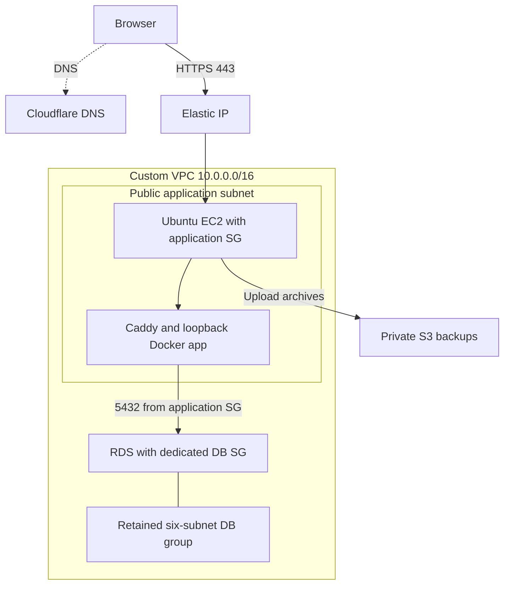

Infrastructure: [Terraform AWS infrastructure](https://github.com/SilvaRohit/myProperty-infra)

# TeceroTech-Property — AWS Infrastructure with Terraform

Infrastructure and operational reference for the TeceroTech-Property portfolio lab: custom networking, EC2, imported RDS, image deployment, recovery, remote Terraform execution, and CloudWatch monitoring.

**Documented:** 23 October 2026  
**Infrastructure repository:** [SilvaRohit/myProperty-infra](https://github.com/SilvaRohit/myProperty-infra)  
**Infrastructure branch:** `main`  
**Application repository:** [SilvaRohit/myProperty](https://github.com/SilvaRohit/myProperty/tree/aws-deployment)  
**AWS region:** `ap-southeast-7` — Thailand  
**HCP organization / workspace:** `tecerotech` / `property-app-dev`

Place this file at the **infrastructure repository root as `README.md`**.

The documentation combines the inspected starting Terraform snapshot with the changes completed during the lab. The latest private infrastructure checkout was not directly available for a final source audit; verify exact file names, input values, and resource addresses against the current checkout and HCP state. The application branch was reviewed at `7d3cd41ad1f2ef5039aeb3b685fbf852707e3c1d`. This is not a fresh audit of the running AWS account.

## Contents

- [1. Project outcome](#1-project-outcome)
- [2. Architecture and network behavior](#2-architecture-and-network-behavior)
- [3. Resource ownership and repository layout](#3-resource-ownership-and-repository-layout)
- [4. Prerequisites and authentication](#4-prerequisites-and-authentication)
- [5. Initial VPC and EC2 provisioning](#5-initial-vpc-and-ec2-provisioning)
- [6. Adopt existing RDS and Elastic IP resources](#6-adopt-existing-rds-and-elastic-ip-resources)
- [7. HCP Terraform state and remote execution](#7-hcp-terraform-state-and-remote-execution)
- [8. OIDC trust and permission boundaries](#8-oidc-trust-and-permission-boundaries)
- [9. Normal infrastructure changes](#9-normal-infrastructure-changes)
- [10. Image delivery and SSM deployment](#10-image-delivery-and-ssm-deployment)
- [11. Database backups and recovery](#11-database-backups-and-recovery)
- [12. S3 upload backups](#12-s3-upload-backups)
- [13. Secrets Manager](#13-secrets-manager)
- [14. EC2 storage expansion](#14-ec2-storage-expansion)
- [15. Monitoring and centralized logs](#15-monitoring-and-centralized-logs)
- [16. Validation and troubleshooting](#16-validation-and-troubleshooting)
- [17. Pause, resume, and decommission](#17-pause-resume-and-decommission)
- [18. Scope limits and future work](#18-scope-limits-and-future-work)
- [19. Portfolio evidence and references](#19-portfolio-evidence-and-references)

## 1. Project outcome

The goal was to build a useful AWS portfolio project from VPC fundamentals through deployment, recovery, and monitoring, using an existing property-management application as the workload.

| Capability | Final lab scope |
|---|---|
| Networking | Custom VPC, public/private subnets, routes, Internet Gateway, application SG |
| Compute | Ubuntu x86_64 EC2, `t3.micro`, encrypted root disk expanded to 30 GiB |
| Addressing | Existing Elastic IP imported and associated with EC2 |
| Database | Existing private-access RDS PostgreSQL adopted into Terraform |
| Database protection | Seven-day automated backups, deletion protection, Terraform destruction guard |
| Registry | ECR repository `property-app-dev` and versioned image delivery |
| Deployment | GitHub OIDC → constrained SSM document → installed EC2 runtime |
| Rollback | Separate GitHub workflow and SSM rollback document |
| State | HCP Terraform remote state, remote runs, VCS integration, manual apply |
| Authentication | Separate HCP plan/apply roles and application GitHub role |
| Upload recovery | Private/versioned S3 backup bucket, lifecycle rules, timer, isolated restore test |
| Configuration | Secrets Manager secret metadata and EC2 read permission |
| Monitoring | EC2 agent metrics, four resource alarms, SNS email, dashboard |
| Logs | Seven-day application log group and scoped EC2 log-write permission |

No ALB, ECS/EKS migration, Multi-AZ RDS, production-mode SvelteKit runtime, direct S3 primary uploads, or scheduled HTTPS availability monitor was included.

The website already uses HTTPS. The omitted feature is **scheduled independent availability monitoring**, not website TLS itself.

## 2. Architecture and network behavior



The subnet-group node records the retained inventory. It does not mean RDS runs in all six subnets. The imported instance is Single-AZ, and its DB subnet group contains both public and private subnets.

### Networking decisions

- VPC DNS support and DNS hostnames are enabled.
- Public subnet internet routing uses an Internet Gateway.
- `map_public_ip_on_launch=false`; EC2 explicitly requested a public IP and later received an Elastic IP.
- NAT Gateway is disabled.
- VPC-local routes allow traffic between public and private subnets, subject to SGs, NACLs, and host controls.
- EC2-to-RDS connectivity inside the VPC does not require a NAT Gateway.
- A private IPv4 address alone does not prove a resource is in a private subnet.
- The DB subnet group's `default-vpc-...` name does not establish that this is the AWS default VPC.

The starting snapshot validated three AZs and three entries in each subnet list. An early tfvars example had two entries, so its counts conflicted with that validation. Match the **current** variable validation and applied subnet inventory; do not copy an older example blindly.

### Final security-group attachment model

| Resource | Attached group | Important rule |
|---|---|---|
| EC2 | `aws_security_group.property_app` | Public 80/443 and lab SSH 22 |
| RDS | Existing dedicated group read by `data.aws_security_group.existing_rds` | TCP 5432 from the EC2 application SG |
| RDS | Application SG | Removed during hardening |

The app SG was previously attached to RDS as well. Removing it from `vpc_security_group_ids` left the dedicated database group as the intended boundary. SG permissions are combined across all attached groups; adding a second group does not cancel broader permissions from the first.

The dedicated DB group's rules remain externally managed/reused through a data source. Terraform manages the RDS attachment but does not thereby own that SG or its rules.

SSH TCP 22 remains open to `0.0.0.0/0` by the explicit lab decision. Broad EC2 outbound IPv4 access also remains. No SSH restriction is claimed.

The web container publishes `127.0.0.1:5173:5173`. Caddy handles public HTTPS 443. RDS is not publicly accessible, and port 5432 is sourced from the application SG rather than a public CIDR.

## 3. Resource ownership and repository layout

### Ownership

| Item | Management boundary |
|---|---|
| VPC module, EC2, app SG/rules | Terraform root |
| Existing RDS instance and DB subnet group | Imported into Terraform |
| Existing Elastic IP and association | Imported into Terraform |
| ECR, GitHub role/policies, deployment documents | Terraform additions |
| Existing EC2 role `instanceRole` | Reused; Terraform manages added policies/profile integration |
| Dedicated RDS SG | Existing external SG read through data source |
| HCP federation roles and bootstrap permissions | Created/configured separately during authentication setup |
| HCP org/workspace/VCS settings | Configured in HCP UI; not all are Terraform resources here |
| Secret metadata and EC2 access policy | Terraform |
| Secret value | Populated separately in Secrets Manager |
| S3 backup bucket and controls | Terraform |
| Caddy, Docker, installed runtime, timer, agent | Host installation/bootstrap steps |
| Cloudflare DNS | Managed separately |
| PITR test DB and isolated restore volume | Temporary operational test resources |

This is adoption of an existing environment. A single `terraform apply` does not currently populate a fresh database, install every host component, and start the complete application.

### Logical file map

Names below reflect the lab's organization. A resource can live in another `.tf` file without changing its Terraform address.

| File or area | Purpose |
|---|---|
| `versions.tf` | AWS provider requirement; HCP cloud block added to the existing Terraform configuration |
| `providers.tf` | Default AWS provider, account guard, default tags |
| Provider `aws.existing` | Alias used for adopted resources in the same account/region |
| `variables.tf` | Account, region, AMI/key pair, network, instance, and other inputs |
| `networking.tf` | VPC module |
| `security.tf` | Application SG and standalone rules |
| `compute.tf` | EC2 and root-volume settings |
| `database.tf` | Imported RDS/subnet-group configuration |
| EIP import configuration | Existing allocation and association |
| `ecr.tf` | ECR repository |
| `github_actions.tf` | GitHub OIDC provider/role and image-push permissions |
| Deployment configuration | Existing EC2 role/profile and deployment SSM document |
| Rollback configuration / `rollback-runtime/` | Rollback SSM document and embedded runtime scripts |
| `s3-backups.tf` | Backup bucket, controls, lifecycle, and EC2 backup access |
| `secrets.tf` | Secret metadata and read permission |
| `monitoring.tf` | EC2 custom-metric publication permission |
| `notifications.tf` | SNS topic/subscription and CloudWatch publish policy |
| `alarms.tf` | EC2 disk/memory alarms |
| `rds-alarms.tf` | RDS CPU/storage alarms |
| `dashboard.tf` | Combined dashboard |
| `logs.tf` | Application log group and EC2 writer policy |
| `outputs.tf` | Resource IDs/addresses and integration values |
| `terraform.tfvars.example` | Example values only |
| `.terraform.lock.hcl` | Tracked provider selections/checksums |

Terraform reads all `.tf` files in the same root directory together. Keeping ECR and GitHub OIDC in separate files is valid; neither needs to be merged into the other.

Commit configuration, examples, and the lockfile. Exclude actual `*.tfvars`, state files/backups, plan files containing sensitive values, private keys, application dotenv files, and `.terraform/`. Retain exceptions for example files.

## 4. Prerequisites and authentication

### Mac tools

- Git.
- AWS CLI v2.
- Terraform matching the HCP workspace's selected version.
- Access to the intended AWS account, HCP organization, and repositories.
- The private key for the existing EC2 key pair, if using SSH.

The lab pinned AWS provider `6.69.1` and VPC module `5.19.0`. Preserve the reviewed lockfile; changing a version is a separate planned change.

Clone the private infrastructure repository using an authorized GitHub identity:

```bash
git clone https://github.com/SilvaRohit/myProperty-infra.git
cd myProperty-infra
```

The original local folder was named `vpc-ec2-rds-v2`. The folder name does not need to match the remote repository name. Confirm:

```bash
git rev-parse --show-toplevel
git remote get-url origin
git branch --show-current
git status
```

### Local AWS identity

```bash
aws configure list-profiles
export AWS_PROFILE=YOUR_LAB_PROFILE
aws sts get-caller-identity
```

Confirm the account before state/import operations. Different profiles can use different authentication methods. `aws login` is not a replacement for an already configured access-key profile unless that profile is deliberately reconfigured.

A working Mac profile does not authenticate an HCP remote run. HCP uses its own OIDC trust and workspace variables.

The default and `existing` providers use `allowed_account_ids` to guard against the wrong account. The alias does not create a separate Terraform state.

## 5. Initial VPC and EC2 provisioning

The initial lab used local Terraform execution/state:

1. Declare providers and input variables.
2. Define VPC/AZ/subnet lists.
3. Create the app SG with standalone ingress/egress rules.
4. Select/pin a verified Canonical Ubuntu x86_64 AMI.
5. Reference an existing key-pair name.
6. Place EC2 in the selected public subnet.
7. Require IMDSv2 and encrypt the root volume.
8. Initialize, validate, review, then apply the first plan.

Initial local workflow, before HCP migration:

```bash
terraform init
terraform fmt -recursive
terraform validate
terraform plan
```

An apply was performed only after reviewing the intended resources. The normal workflow is now the HCP/VCS process in section 9.

### Main inputs

| Variable | Notes |
|---|---|
| `aws_account_id` | Intended 12-digit account ID |
| `aws_region` | `ap-southeast-7` |
| `project_name` / `environment` | `property-app` / `dev` |
| `ubuntu_ami_id` | Existing verified Canonical AMI for this region and architecture |
| `instance_type` | `t3.micro` |
| `instance_name` | `property-app` |
| `key_pair_name` | Existing regional key pair name |
| `admin_cidr` | Still a required input in the lab; the SSH rule currently uses open IPv4 instead |
| Network lists | Must satisfy current count/CIDR/AZ validation |
| `deployment_existing_ec2_role_name` | `instanceRole` |
| `alert_email` | Confirmed SNS recipient, set in HCP |

A file named `terraform.tfvars.example` is not automatically loaded as real values. A private local `terraform.tfvars` also does not automatically appear in an HCP VCS checkout. Put required remote inputs in the workspace or a deliberately managed nonsecret configuration.

The actual host reported Ubuntu 26.04. The earlier AMI search example targeted Ubuntu 24.04. Keep the pinned existing AMI unless an instance replacement is intended; a `most_recent=true` lookup can select a different image later.

## 6. Adopt existing RDS and Elastic IP resources

### Why import

The DB and Elastic IP were created manually after the initial Terraform stage. Import adds existing AWS objects to Terraform state; it does not copy the data or create replacement objects.

The first goal was a plan matching the existing configuration. Improvements such as longer retention and SG cleanup were separate changes.

### RDS inventory captured during adoption

| Setting | Captured lab configuration |
|---|---|
| Identifier | `property-app-db` |
| Engine | PostgreSQL 18.3 at adoption |
| Class | `db.t4g.micro` |
| Storage | 20 GiB, `gp2`, encrypted |
| Maximum autoscaling storage | 1000 GiB in the imported configuration |
| Public access | Disabled |
| Multi-AZ | Disabled |
| SQL DBName reported by RDS API | `null` |
| Actual SQL application database | `propertyapp` |
| Subnet group | Existing six-subnet group |
| Parameter group | `default.postgres18` |
| Backup retention at adoption | 1 day, later changed to 7 |
| Deletion protection at adoption | False, later enabled |
| Enhanced Monitoring interval | 0 |
| Performance Insights flag | Reported enabled at adoption |

`DBName=null` does not mean there is no SQL database. The application DB was created manually. Adding `db_name="propertyapp"` to force the API metadata to match is not a harmless naming correction; preserve the imported resource and inspect the plan.

The imported KMS key and other account-specific settings must match the actual database. Do not replace an existing encryption key casually.

### Import examples

These are **adoption examples for resources not already in state**. Do not repeat them on the completed workspace.

```hcl
import {
  to       = aws_db_instance.existing_property_db
  id       = "property-app-db"
  provider = aws.existing
}

import {
  to       = aws_db_subnet_group.existing_property_db
  id       = "YOUR_EXISTING_DB_SUBNET_GROUP"
  provider = aws.existing
}

import {
  to       = aws_eip.existing_property_app
  id       = "YOUR_EIP_ALLOCATION_ID"
  provider = aws.existing
}

import {
  to       = aws_eip_association.existing_property_app
  id       = "YOUR_EIP_ASSOCIATION_ID"
  provider = aws.existing
}
```

Use the addresses actually declared in your checkout. Each remote object should be bound to one resource address, not imported twice under competing definitions.

The EIP allocation is managed separately from its association. Do not also configure competing `instance`/`network_interface` association management on the EIP resource.

### Protection and plan review

The lab adopted:

- `prevent_destroy` guards for protected imported resources.
- RDS `deletion_protection=true` after the protection stage.
- `skip_final_snapshot=false` and a final snapshot identifier.
- `apply_immediately=false` for appropriate RDS changes.

Terraform-only settings such as final-snapshot behavior can appear as in-place changes after import. Review each diff; `0 to destroy` does not mean every change is operationally harmless.

A fixed final snapshot name can collide with an existing snapshot during future deletion. Choose an available final identifier as part of a deliberate decommission.

### Final RDS SG attachment

```hcl
vpc_security_group_ids = [
  data.aws_security_group.existing_rds.id,
]
```

The EC2 application SG is no longer attached to RDS. Its ID is instead the source of TCP 5432 in the dedicated DB SG.

## 7. HCP Terraform state and remote execution

### Selected backend

State is in **HCP Terraform**, organization `tecerotech`, workspace `property-app-dev`. S3 was discussed as an alternative state backend but not selected. The S3 bucket in this project is for **upload backups**, not Terraform state.

Merge the cloud configuration into the existing Terraform block, preserving provider requirements:

```hcl
terraform {
  cloud {
    organization = "tecerotech"

    workspaces {
      name = "property-app-dev"
    }
  }

  required_providers {
    aws = {
      source  = "hashicorp/aws"
      version = "6.69.1"
    }
  }
}
```

Do not enable an S3 backend block at the same time.

### Initial migration, already completed

1. Securely back up the existing local state.
2. Create/select the intended HCP workspace.
3. Add the cloud block.
4. Run `terraform login` and `terraform init`.
5. Follow the state migration prompts and verify the resource inventory.
6. Confirm remote execution, inputs, and AWS identity.
7. Connect `myProperty-infra/main` through VCS.
8. Use speculative PR plans and manually approved applies.

For an existing migrated checkout:

```bash
terraform login
terraform init
terraform workspace show
terraform state list
```

Do not create a second empty workspace or re-import existing resources because a local state file is gone. HCP state is authoritative.

### Remote inputs

Environment variables:

| Key | Value |
|---|---|
| `TFC_AWS_PROVIDER_AUTH` | `true` |
| `TFC_AWS_PLAN_ROLE_ARN` | ARN of `tecerotech-hcp-property-plan` |
| `TFC_AWS_APPLY_ROLE_ARN` | ARN of `tecerotech-hcp-property-apply` |
| `AWS_REGION` | `ap-southeast-7` |

Terraform-category variables include required inputs from section 5, particularly `admin_cidr`, `deployment_existing_ec2_role_name=instanceRole`, and `alert_email`, plus account/AMI/key-pair values where required by the actual configuration.

Use the appropriate HCP category. Do not store AWS access keys as Terraform variables. If separate provider credential configurations are introduced later, follow HashiCorp's default/tagged dynamic-credential mapping; do not assume alias names alone select different identities.

## 8. OIDC trust and permission boundaries

### Four distinct AWS identities

| Identity | Purpose |
|---|---|
| HCP plan role | Refresh/read resources and calculate proposed changes |
| HCP apply role | Apply reviewed infrastructure changes |
| GitHub application role | Push ECR images and invoke permitted deploy/rollback documents |
| EC2 instance role | Pull images, receive SSM commands, read config, write backups/logs/metrics |

The table contains separate trust domains; a credential problem in one is not repaired by changing another.

### HCP trust

Issuer: `https://app.terraform.io`  
Default audience: `aws.workload.identity`

The subject includes organization, **actual project name**, workspace, and phase:

```text
organization:tecerotech:project:YOUR_ACTUAL_HCP_PROJECT:workspace:property-app-dev:run_phase:plan
organization:tecerotech:project:YOUR_ACTUAL_HCP_PROJECT:workspace:property-app-dev:run_phase:apply
```

The project name must match exactly, including spaces/case. Do not assume it is `Default Project` without checking.

Example plan-role trust template:

```json
{
  "Version": "2012-10-17",
  "Statement": [
    {
      "Effect": "Allow",
      "Principal": {
        "Federated": "arn:aws:iam::YOUR_ACCOUNT_ID:oidc-provider/app.terraform.io"
      },
      "Action": "sts:AssumeRoleWithWebIdentity",
      "Condition": {
        "StringEquals": {
          "app.terraform.io:aud": "aws.workload.identity",
          "app.terraform.io:sub": "organization:tecerotech:project:YOUR_ACTUAL_HCP_PROJECT:workspace:property-app-dev:run_phase:plan"
        }
      }
    }
  ]
}
```

Use the corresponding `apply` subject for the apply role. Trust permits role assumption; permission policies determine allowed AWS operations. Both must be correct.

### HCP permissions used in the lab

The plan role used AWS-managed `ReadOnlyAccess`. `AmazonEC2ReadOnlyAccess` alone is insufficient for a root containing RDS, IAM, S3, ECR, SSM, Secrets Manager, and CloudWatch.

The apply role used read access plus scoped write policies added as features were introduced:

| Feature | Write scope |
|---|---|
| Portfolio EC2 tag | Intended EC2 instance |
| RDS changes | Existing DB ARN |
| Backup bucket | Application backup bucket |
| EC2 inline policies | Existing `instanceRole` |
| Secret metadata | `property-app/dev/config` secret ARN pattern |
| Deploy/rollback documents | Their named SSM documents |
| Root-volume growth | Existing root EBS volume |
| SNS | `property-app-dev-alerts` topic |
| Resource alarms | `property-app-dev-*` alarm ARN prefix |
| Dashboard | `property-app-dev` dashboard ARN |
| Application logs | `/tecerotech/property-app/dev` log group |

The staged policies were sufficient for the operations exercised. They are not a universal permission set for rebuilding or deleting every resource. New capabilities may require reviewed additions. AWS-managed read access is broad account read access, so this is not a formally verified minimal-permission design.

### GitHub trust

Issuer: `https://token.actions.githubusercontent.com`  
Audience: `sts.amazonaws.com`  
Scope: the application repository on `refs/heads/aws-deployment`.

The lab's OIDC configuration supports its repository's actual subject format, including immutable owner/repository identifiers where emitted. Verify the actual `sub` claim; do not broaden trust to every repository or branch to fix a mismatch.

The GitHub role pushes to one ECR repository and sends commands only through the named documents to the intended EC2 instance. `ssm:GetCommandInvocation` is used to observe the result.

### EC2 role

The instance reuses `instanceRole` through the deployment profile integration. It receives:

- SSM managed-instance permissions.
- ECR authorization/token and image-pull permissions.
- Scoped secret read access.
- Upload backup/read access under the S3 `uploads/` prefix.
- `cloudwatch:PutMetricData` limited to namespace `CWAgent`, plus EC2 metric metadata reads.
- `logs:CreateLogStream` and `logs:PutLogEvents` inside the application log group.

No new scheduled HTTPS-check Lambda or Scheduler role was created.

## 9. Normal infrastructure changes

Use a branch/PR and HCP plan review:

```bash
git switch main
git pull --ff-only origin main
git switch -c feature/describe-the-change

# Edit the intended Terraform configuration.
terraform fmt -recursive
terraform init
terraform validate

git diff
git add PATH_TO_CHANGED_FILE
git commit -m "Describe the infrastructure change"
git push -u origin feature/describe-the-change
```

Then:

1. Open a PR into `main`.
2. Inspect the HCP speculative plan.
3. Investigate unrelated diffs or replacements.
4. Merge the reviewed change.
5. Inspect the resulting HCP run.
6. Approve its apply when the planned change is correct.
7. Verify the AWS result relevant to that change.

Do not assume speculative plans have applied anything. Do not run competing local applies against an environment whose execution is managed through VCS.

### Meaningful plan checks

- Is EC2 being replaced because the AMI changed?
- Is an imported RDS setting unexpectedly forcing replacement?
- Does the RDS SG list preserve only the intended dedicated group?
- Is an instance-profile role switching as intended?
- Does a protection setting intentionally prevent destruction?
- Is storage increasing, rather than attempting an unsupported decrease?
- Are unrelated resources changing due to defaults, tags, or configuration drift?

A plan containing destroy actions is not automatically wrong: the lab deliberately replaced role-policy attachments when switching to the existing role. Review the identities and impact rather than judging only counts.

## 10. Image delivery and SSM deployment

### ECR and GitHub

Repository: `property-app-dev` in `ap-southeast-7`. Images use:

```text
sha-FULL_GIT_SHA-run-GITHUB_RUN_ID-GITHUB_RUN_ATTEMPT
```

The application pipeline builds `linux/amd64`, runs coverage inside that exact image, pushes it, then invokes SSM.

Keep the ECR and OIDC Terraform in separate files if preferred. They are in one root module and can reference each other.

### Deployment document

Resource: `aws_ssm_document.property_deploy`  
Name: `property-app-dev-deploy-property-app`  
Parameter: `ImageUri`  
Schema: `2.2` with `interpolationType="ENV_VAR"`

The parameter pattern permits the intended account/region/repository and versioned tag format. The runtime receives the value as `SSM_ImageUri`.

The command order is:

```text
set -eu
/opt/property-app-deploy/refresh-env.sh
exec /opt/property-app-deploy/deploy.sh "$SSM_ImageUri"
```

The document is a constrained deployment interface. GitHub does not need arbitrary administrator shell access through `AWS-RunShellScript`.

### Rollback document

Resource: `aws_ssm_document.property_rollback`  
Name: `property-app-dev-rollback-property-app`  
Parameter: numeric `RequestId` from the GitHub run ID.

The document embeds the reviewed `rollback-runtime/` wrapper/deployment script and refreshes the current secret before rollback. Preserve the wrapper's idempotency behavior.

Do not drop the runtime directory from Git: Terraform's `file()` / `filebase64()` calls need those files in the HCP VCS checkout.

### EC2 installation boundary

The app repository contains deployment, backup, environment-refresh, metrics, and Compose sources. The active copies live under `/opt/property-app-deploy` or system configuration paths.

Installing a new SSM document does not magically install every host file. Likewise, an image deployment does not copy a changed Compose template. The application README documents the one-time adoption and subsequent runtime-template update procedures.

The GitHub rollback button remains the operating path; automatic deployment stays enabled. A rollback is not a database restore or a Terraform rollback.

## 11. Database backups and recovery

### Protection settings

The completed protection stage set:

- Automated backup retention to **7 days**.
- RDS deletion protection to **true**.
- Terraform `prevent_destroy` on the protected DB resource.
- Final snapshot behavior configured for deliberate deletion.

The imported backup window was `08:34–09:04 UTC` and maintenance window `Friday 15:10–15:40 UTC`. Check the current DB settings/pending modifications rather than assuming every change is immediate.

Inspect on the Mac:

```bash
aws rds describe-db-instances \
  --region ap-southeast-7 \
  --db-instance-identifier property-app-db \
  --query 'DBInstances[0].{Status:DBInstanceStatus,Retention:BackupRetentionPeriod,DeletionProtection:DeletionProtection,LatestRestorableTime:LatestRestorableTime,Pending:PendingModifiedValues}' \
  --output json
```

### Point-in-time recovery test

1. Check that the original DB has an available restorable time.
2. Restore to a **new** identifier, `property-app-db-restore-test`.
3. Preserve the intended VPC/subnet-group/private-access configuration.
4. Verify the restored instance's dedicated DB SG attachment.
5. Wait for availability and obtain its separate endpoint.
6. Connect from EC2 over verified TLS to SQL database `propertyapp`.
7. Compare known data with the original.
8. Delete only the temporary test instance after validation.

The source application kept using the original DB.

SQL used on both instances:

```sql
SELECT COUNT(*) AS property_count FROM public.property;
SELECT COUNT(*) AS unit_count FROM public.unit;
```

Observed counts were **1 property** and **10 units** in each.

This demonstrates basic PITR/data recovery. It did not validate every table, measure RTO/RPO, perform app failover, or coordinate database restoration with upload archives.

The temporary restore instance was an operational test, not a second persistent Terraform DB resource. Verify cleanup in RDS after each test; it incurs its own instance/storage charges while retained.

## 12. S3 upload backups

### Bucket controls

The application backup bucket follows `tecerotech-property-ACCOUNT_ID-backups`. It is different from any Terraform-state backend.

Terraform added:

- All Block Public Access controls.
- Bucket-owner-enforced object ownership.
- SSE-S3 encryption.
- Versioning.
- HTTPS-only bucket access policy.
- `force_destroy=false` and a destruction guard.
- Lifecycle rules scoped to `uploads/`.

### Lifecycle behavior

| Rule | Lab setting |
|---|---|
| Current object expiration | 30 days |
| Noncurrent version expiration | 30 days after becoming noncurrent |
| Incomplete multipart upload cleanup | 7 days |
| Expired delete-marker cleanup | Separate applicable rule |

In a versioned bucket, current expiration generally creates a delete marker and makes the previous data version noncurrent. Permanent deletion follows the noncurrent rule later. Therefore an otherwise unchanged backup can remain physically stored for approximately 60 days, plus lifecycle processing delay; do not describe the configuration as permanent deletion of all data at day 30.

This lifecycle is for backups. It should not be reused unchanged for a primary tenant-document bucket.

### EC2 S3 permissions

The added role policy allows the needed bucket/prefix listing and location reads, plus upload, object/version read, and multipart abort under `uploads/`. It does not grant object deletion to the EC2 backup job.

### Host schedule and evidence

The application repository supplies the archive script and systemd units. They were installed on EC2 with a daily **02:00 Asia/Bangkok** schedule and `Persistent=true`.

The timer's enabled/next-run state proves scheduling, not successful execution. Check the service journal and actual S3 objects.

The recovery exercise:

1. Found an empty initial upload archive.
2. Wrote a known synthetic test file into the real uploads volume.
3. Created a fresh backup.
4. Downloaded its archive/checksum.
5. Verified SHA-256.
6. Extracted into an isolated Docker volume.
7. Read the synthetic recovery message.

See the application README for exact restore commands. The live volume was not replaced during the test.

## 13. Secrets Manager

Secret: `property-app/dev/config`.

Terraform manages secret metadata, recovery-window settings, protection, and EC2 read permission. The value is populated separately as a plaintext dotenv document.

The lab used a seven-day secret deletion recovery window and `prevent_destroy`. There is no Terraform-managed application secret version in this workflow.

Do not infer that Terraform state is generally safe to publish: state can contain sensitive infrastructure data or historical values, even when outputs are marked sensitive.

The EC2 refresh script retrieves `AWSCURRENT` and atomically replaces the environment file after required-key checks. Deploy and rollback run it before switching images.

This does not implement automatic credential rotation, a dedicated SQL app user, or coordinated rollback to an old secret version.

## 14. EC2 storage expansion

### Problem

The original 8 GiB EBS volume left about 6.7 GiB usable at `/`. Docker/containerd image extraction exhausted it, including layers containing development/test dependencies.

Pruning build cache helped temporarily, but repeated pulls still failed. Removing every cached image would also weaken rollback readiness.

### Terraform change

In `compute.tf`:

```hcl
root_block_device {
  encrypted   = true
  volume_size = 30
}
```

Apply through the reviewed HCP workflow. The existing volume ID remaining unchanged is expected for an in-place expansion.

### Linux filesystem growth

After AWS reports the larger block device, inspect EC2:

```bash
lsblk -o NAME,SIZE,FSTYPE,MOUNTPOINTS
df -hT /
```

The lab used an NVMe root disk with ext4 root on `/dev/nvme0n1p1`. After confirming those exact device/filesystem identities:

```bash
sudo growpart /dev/nvme0n1 1
sudo resize2fs /dev/nvme0n1p1
df -hT /
```

Install `cloud-guest-utils` if `growpart` is missing. Different device names/filesystems require their own correct procedure.

Terraform changing the EBS size does not prove the partition/filesystem grew. Check both layers. EBS volumes cannot be shrunk with a reverse size edit.

## 15. Monitoring and centralized logs

### EC2 custom metrics

Terraform grants `instanceRole` permission to publish only namespace `CWAgent`, plus EC2 tag/volume metadata reads.

The host CloudWatch Agent collects root-disk and memory usage every 60 seconds. It appends `InstanceId` and rolls disk metrics up to that dimension. The reviewed application file `deploy/cloudwatch-agent.json` is the configuration source.

Install AWS's Ubuntu amd64 package on the x86_64 host:

```bash
curl -fSL \
  https://amazoncloudwatch-agent.s3.amazonaws.com/ubuntu/amd64/latest/amazon-cloudwatch-agent.deb \
  -o /tmp/amazon-cloudwatch-agent.deb
sudo dpkg -i /tmp/amazon-cloudwatch-agent.deb

sudo install -m 0644 \
  /home/ubuntu/myProperty/deploy/cloudwatch-agent.json \
  /opt/aws/amazon-cloudwatch-agent/etc/property-app.json

sudo python3 -m json.tool \
  /opt/aws/amazon-cloudwatch-agent/etc/property-app.json

sudo /opt/aws/amazon-cloudwatch-agent/bin/amazon-cloudwatch-agent-ctl \
  -a fetch-config -m ec2 -s \
  -c file:/opt/aws/amazon-cloudwatch-agent/etc/property-app.json

sudo systemctl enable amazon-cloudwatch-agent
```

Memory's `drop_original_metrics` setting was removed because its original metric already used the target dimension set. Suppressing that original left no published memory series. Keep the fixed source under Git.

### SNS and alarm permissions

SNS topic: `property-app-dev-alerts`.

The recipient is supplied through HCP Terraform variable `alert_email` and must confirm the email subscription.

The topic policy permits `cloudwatch.amazonaws.com` to publish, conditioned on the intended account and `property-app-dev-*` alarm ARN prefix. Terraform's apply role has topic-management permissions; EC2 does not need SNS publish permission for CloudWatch alarm notifications.

### Four resource alarms

| Alarm | Namespace / metric | Statistic | Threshold |
|---|---|---|---|
| `property-app-dev-ec2-disk-high` | `CWAgent / disk_used_percent` | Maximum | >= 80% |
| `property-app-dev-ec2-memory-high` | `CWAgent / mem_used_percent` | Average | >= 85% |
| `property-app-dev-rds-cpu` | `AWS/RDS / CPUUtilization` | Average | >= 80% |
| `property-app-dev-rds-storage` | `AWS/RDS / FreeStorageSpace` | Minimum | < 5 GiB |

Common settings: `period=60`, `evaluation_periods=5`, `datapoints_to_alarm=3`, `treat_missing_data="missing"`. ALARM, OK, and INSUFFICIENT_DATA actions target SNS.

EC2 dimensions use `InstanceId` only for the aggregated custom series. RDS dimensions use `DBInstanceIdentifier=property-app-db`, not the SQL name `propertyapp` or an opaque RDS resource ID.

The 5 GiB threshold is `5 * 1024 * 1024 * 1024` bytes. Thresholds are initial lab choices, not universal production recommendations.

### Dashboard

Dashboard `property-app-dev` contains:

- Four alarm states.
- EC2 CPU, memory, root-disk usage, and status-check failures.
- RDS CPU, connections, free storage, and freeable memory.

Default view: last three hours. Graph period: 300 seconds. Alarm periods remain 60 seconds.

Dashboard IAM ARNs have no region segment:

```text
arn:aws:cloudwatch::YOUR_ACCOUNT_ID:dashboard/property-app-dev
```

### Application log group

`logs.tf` creates `/tecerotech/property-app/dev` with seven-day retention and an EC2 inline policy allowing stream creation/event writes inside that group.

The current Compose template uses Docker's `awslogs` driver, per-container streams, non-blocking delivery, and bounded local cache. The template was separately installed into the active runtime and the container recreated.

The host metrics agent does not collect the app logs in this design. No new host-wide Docker logging default was required.

Before forwarding, login request bodies, request/document debug dumps, and raw API exception logs were removed/sanitized. The database logging flag is set through the protected application configuration.

### Alert test

From the Mac, with the disk alarm initially OK:

```bash
aws cloudwatch set-alarm-state \
  --region ap-southeast-7 \
  --alarm-name property-app-dev-ec2-disk-high \
  --state-value ALARM \
  --state-reason "Portfolio notification test"
```

Check SNS email and alarm History. CloudWatch soon reevaluates the actual metric state. This tests notification routing, not a real threshold breach.

There is no scheduled HTTPS monitor, no EC2 CPU/status alarm beyond their dashboard charts, and no dedicated backup-job failure alarm in the completed scope.

## 16. Validation and troubleshooting

### Identify current infrastructure

Run from the Mac with the intended AWS profile:

```bash
aws sts get-caller-identity

aws ec2 describe-instances \
  --region ap-southeast-7 \
  --instance-ids YOUR_INSTANCE_ID \
  --query 'Reservations[0].Instances[0].{State:State.Name,Vpc:VpcId,Subnet:SubnetId,Groups:SecurityGroups,Profile:IamInstanceProfile.Arn}' \
  --output json

aws rds describe-db-instances \
  --region ap-southeast-7 \
  --db-instance-identifier property-app-db \
  --query 'DBInstances[0].{Status:DBInstanceStatus,Vpc:DBSubnetGroup.VpcId,Public:PubliclyAccessible,Groups:VpcSecurityGroups,Endpoint:Endpoint.Address}' \
  --output json
```

These reads verify current facts without selecting passwords or secret contents.

### Confirm SSM

```bash
aws ssm describe-instance-information \
  --region ap-southeast-7 \
  --filters Key=InstanceIds,Values=YOUR_INSTANCE_ID \
  --query 'InstanceInformationList[].{Instance:InstanceId,Status:PingStatus,Agent:AgentVersion}' \
  --output table
```

Agent online status and successful command delivery were tested in the lab. Interactive Session Manager access was not independently confirmed as a replacement for SSH.

### Failure reference

| Error | Likely boundary / fix |
|---|---|
| `No valid credential sources found` locally | Correct local profile/login/session and account |
| Same error in HCP | Workspace auth variables and federation trust, not the Mac profile |
| `AssumeRoleWithWebIdentity` 403 | Exact issuer/audience/organization/project/workspace/phase and role ARN |
| `No value for required variable admin_cidr` | Add remote Terraform-category input |
| Undeclared VPC/SG reference | Use real module outputs/resource addresses |
| AMI update replaces EC2 | Pin existing verified AMI and review lifecycle impact |
| RDS replacement after import | Preserve captured immutable settings; inspect the forcing attribute |
| Plan removes deployment role | Review existing-role variable and intentional role/profile switch |
| NoSuchEntity for GitHub provider | Account-level OIDC provider absent or wrong account |
| SSM Undeliverable | Agent/instance state, role, account/region, network and delivery timeout |
| RDS timeout | Dedicated DB SG source, VPC/routes/NACLs, current endpoint |
| RDS database not found | SQL database name differs from AWS identifier |
| ECR extraction fills root | AWS volume, partition, filesystem, and image/cache sizes |
| Same volume ID after apply | Normal in-place volume expansion |
| Agent cannot translate JSON | Trailing comma/invalid schema; inspect validation log |
| Memory metric absent | Remove inappropriate original suppression, apply valid config |
| Dashboard no data | Exact namespace/name/dimension set and selected account/region/time |
| SNS no email | Confirm subscription, check topic policy, state transition, and alarm History |
| Destroy leaves resources | State boundary, data sources, manual resources, protections and retained data |

For memory diagnosis on the Mac:

```bash
aws cloudwatch list-metrics \
  --region ap-southeast-7 \
  --namespace CWAgent \
  --metric-name mem_used_percent \
  --output json
```

New series can take up to 15 minutes to appear in metric listings. Agent `running` status alone does not prove publication.

On EC2:

```bash
sudo /opt/aws/amazon-cloudwatch-agent/bin/amazon-cloudwatch-agent-ctl \
  -m ec2 -a status
sudo tail -n 80 /opt/aws/amazon-cloudwatch-agent/logs/configuration-validation.log
sudo tail -n 50 /opt/aws/amazon-cloudwatch-agent/logs/amazon-cloudwatch-agent.log
```

## 17. Pause, resume, and decommission

### Ending the exercise

Concluding the lab is not an AWS stop/delete operation. Running resources remain active until deliberately stopped or removed.

### Temporary pause

A temporary pause can stop EC2 and the eligible RDS instance. Preserve disks, database storage, snapshots, EIP allocation, and configuration if resuming.

- Resource alarms may send INSUFFICIENT_DATA emails.
- GitHub app deployments can fail while EC2/RDS are unavailable.
- S3 backup timers cannot execute while EC2 is stopped.
- RDS automatically starts again after seven consecutive stopped days.
- Retained storage, snapshots, allocated public IPv4, ECR/S3 objects, and telemetry can still cost money.

Resume RDS first and wait for availability, then start EC2 and verify Docker/Caddy/SSM/agent, the website, and the backup timer. No automated pause/resume schedule was added.

### Deliberate deletion

`terraform destroy` operates on managed state; it does not mean everything in the AWS account will disappear.

Before decommissioning:

1. Inventory state and all external/manual resources.
2. Decide what data and recovery artifacts must be retained.
3. Review a destroy plan in the correct workspace/account.
4. Address protected resources only as a deliberate change.
5. Arrange an available final DB snapshot name if deleting RDS.
6. Handle S3 object versions/delete markers explicitly; `force_destroy=false` prevents an automatic nonempty-bucket purge.
7. Inspect secret recovery windows, retained snapshots, EIP allocation, ECR images, OIDC/IAM bootstrap objects, Cloudflare records, and temporary test resources afterward.

Do not remove the state to make a protected resource disappear. Removing state ownership is not resource deletion and can make future management harder.

The staged HCP apply policies may not permit every destructive API. A completed teardown also requires verifying actual AWS inventory and billing resources.

## 18. Scope limits and future work

| Area | Current limit / possible later improvement |
|---|---|
| Availability | Single host/container and Single-AZ DB; no ALB/autoscaling |
| Runtime | Vite development server; production adapter/image deferred |
| Host automation | Manual/bootstrap components remain |
| State | HCP selected; S3 state backend example is unused |
| Network | No NAT; retained DB subnet group mixes subnet classes |
| RDS SG | Rules externally managed through reused group |
| SQL permissions | Master login retained; dedicated app role deferred |
| Schema | Synchronization used; verified migrations not delivered |
| App quality | Selected fixes, incomplete business/security QA |
| Deployment | In-place recreation; not zero downtime |
| Runtime synchronization | Not every Git script/template is automatically installed |
| Backups | File and DB recovery separate; no full-system consistency/RTO proof |
| Storage | Docker uploads with S3 backups, not direct S3 primary storage |
| Administration | SSH intentionally open |
| Monitoring | No scheduled HTTPS availability monitor |
| Logging | App logs centralized; not every host/proxy/database log |
| Security/cost | No claim that account-wide audit/security/cost automation was completed |

These are documented next-version possibilities. They are not prerequisites silently added to this lab's completion.

## 19. Portfolio evidence and references

This project demonstrates:

- VPC/subnet/routing and SG reasoning.
- Moving from manual resources to infrastructure as code.
- Safe adoption/import rather than unnecessary DB replacement.
- Separating trust policies from AWS permissions.
- Distinguishing local CLI, HCP, GitHub, and EC2 identities.
- Temporary OIDC credentials for automation.
- Versioned releases and request-idempotent rollback.
- Backup validation and isolated recovery exercises.
- Capacity troubleshooting across AWS volumes and Linux filesystems.
- Custom metrics, notification routing, dashboards, and centralized logs.
- Honest documentation of implemented scope and remaining risks.

Recommended evidence is the real plan/apply history, workflows, sanitized architecture, versioned image history, backup/recovery results, and CloudWatch views. Avoid claiming production HA, complete security hardening, or one-shot rebuilds that the implementation does not provide.

### Primary references

- [Application operations guide repository](https://github.com/SilvaRohit/myProperty/tree/aws-deployment)
- [HCP cloud configuration and migration](https://developer.hashicorp.com/terraform/cli/cloud/settings)
- [HCP AWS dynamic credentials](https://developer.hashicorp.com/terraform/cloud-docs/dynamic-provider-credentials/aws-configuration)
- [Terraform resource import](https://developer.hashicorp.com/terraform/language/import)
- [AWS provider DB instance resource](https://registry.terraform.io/providers/hashicorp/aws/latest/docs/resources/db_instance)
- [VPC module](https://registry.terraform.io/modules/terraform-aws-modules/vpc/aws/5.19.0)
- [RDS point-in-time recovery](https://docs.aws.amazon.com/AmazonRDS/latest/UserGuide/USER_PIT.html)
- [Stopping RDS and automatic restart](https://docs.aws.amazon.com/AmazonRDS/latest/UserGuide/USER_StopInstance.html)
- [S3 lifecycle expiration](https://docs.aws.amazon.com/AmazonS3/latest/userguide/lifecycle-expire-general-considerations.html)
- [CloudWatch Agent configuration](https://docs.aws.amazon.com/AmazonCloudWatch/latest/monitoring/CloudWatch-Agent-Configuration-File-Details.html)
- [CloudWatch alarm notifications and SNS policy](https://docs.aws.amazon.com/AmazonCloudWatch/latest/monitoring/Notify_Users_Alarm_Changes.html)
- [CloudWatch dashboard syntax](https://docs.aws.amazon.com/AmazonCloudWatch/latest/monitoring/CloudWatch-Dashboard-Body-Structure.html)
- [Docker awslogs driver](https://docs.docker.com/engine/logging/drivers/awslogs/)
- [AWS Pricing Calculator](https://calculator.aws/)

